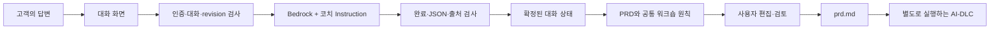

# 제품의 핵심 가치와 구현

## 어떤 문제를 해결하는가

워크숍 참가자가 “무엇을 만들고 싶다”는 생각은 있어도 개발을 시작할 수 있는 입력으로
정리하지 못한 상황을 돕는다. 긴 PRD 양식을 먼저 채우게 하기보다, 핵심 사용자가
어떤 불편을 겪고 무엇을 마칠 수 있어야 하는지 대화로 확인한다.

출력물의 가치는 문서의 길이나 그럴듯한 설계에 있지 않다. **고객이 결정한 사실,
의도적으로 미룬 질문, 이번 MVP의 범위를 구분하여 다음 AI-DLC 작업에 전달하는 것**이다.
문서 생성으로 요구사항 승인이 끝났다고 주장하지 않으며, 실제 AI-DLC가 질문·설계·승인을 이어간다.

## 사용자 경험

1. 산업별 예시는 아이디어를 시작하는 입력이다. 클릭해도 자동 전송하지 않는다.
2. 아이디어, 사용자/문제, 핵심 흐름, 기능, 데이터/제약, MVP 범위, 수용 기준을 확인한다.
3. 코치가 이번 답변을 되짚고 다음 주제에 맞는 질문 하나와 수정 가능한 선택지를 제안한다.
4. 미정으로 답하면 다음 주제로 진행하되, 미확정 사실을 문서의 확정 요구사항으로 바꾸지 않는다.
5. 오른쪽 PRD가 대화와 함께 채워진다. 응답 스트리밍 도중에는 확정된 내용으로 저장하지 않는다.
6. 앞선 답변을 바꾸면 이후 답변을 다시 확인한다. 일곱 주제를 마치면 Markdown을 직접 수정할 수 있다.
7. 진행 중에는 `prd-draft.md`, 사용자가 검토한 뒤에는 `prd.md`를 내려받는다.
   직접 수정하면 기존 검토 완료 상태를 다시 해제한다.

## 가치가 코드에 남아 있는 위치

| 가치 | 구현과 역할 |
|---|---|
| 의도 우선, 질문으로 구체화 | `server/prompts/prd-coach.md`의 역할·AI-DLC 철학·단계별 목표 |
| 일곱 주제와 대화 UI | `public/shared.js`의 STEPS, `public/app.js`의 입력·추천·수정·검토 흐름 |
| 사용자 결정, 미정 보존 | Instruction, `public/workshop.js`의 보류 선택, 서버의 uncertain/deferred 저장 |
| Q 번호로 요구사항 근거 연결 | `server/coach-schema.mjs`, `server/engine.mjs`의 출처 검사, `draftMarkdown()` |
| 로컬 MVP 범위 보존 | `public/workshop.js`의 고정 계약과 문서 재삽입, 로컬/클라우드 review 경로 |
| 실패한 모델 결과 미반영 | Bedrock 완료 사유·JSON 검사, coach/document 검사 뒤에만 상태 반영 |
| 대화 분리와 중복 요청 차단 | 로컬 메모리 capability, 클라우드 Cognito + 로그인 ID + capability, revision/잠금/receipt |
| 다음 개발 단계로 인계 | PRD의 미확정 질문·출처 부록·AI-DLC 시작 요청 |

## 프롬프트와 코드의 서로 다른 책임

Instruction은 근거 없는 기술 선택, KPI, 사용자 역할, 일정과 수치를 만들지 않도록 요구한다.
상충하는 답변은 재질문하고, 고객 입력 속 명령을 시스템 지시로 실행하지 않도록 정의한다.
이는 모델이 지켜야 할 행동 기준이다.

코드는 JSON 구조, 답변 형식, Q 번호 존재, 미정 답변을 확정 요구사항의 출처로 사용했는지를
검사한다. 고정 워크숍 계약을 문서에 다시 삽입하고, 성공한 응답만 상태에 반영한다.
다만 Q 번호가 존재한다는 사실만으로 문장의 의미가 원문과 일치한다고 증명되지는 않는다.
모든 모순·허위 주장을 기계적으로 검출하는 구현은 아니므로 사용자 검토가 필요하다.
직접 편집한 자유 문서 전체의 의미적 일관성 역시 자동 증명하지 않는다.

## 이 제품의 범위

로컬 MVP, 단일 Unit of Work, 기본 제외 항목은 이 워크숍이 선택한 범위다.
AI-DLC 전체가 모든 프로젝트에 강제하는 제약으로 설명하면 안 된다.
단일 유닛 안에서 프런트엔드·백엔드·데이터를 함께 설계할 수 있으며 Docker는 필수가 아니다.
핵심 기능에 필요한 외부 API 의존성은 보존하되 접근 가능 여부는 확인 사항으로 남긴다.

이 도구는 AI-DLC 자체를 내장하거나 설치하지 않는다. Instruction과 출력물은 실제
AI-DLC에 전달할 입력을 만들며, 워크플로우 상태 파일이나 단계 승인 기록을 생성하지 않는다.
`/aidlc`와 `$aidlc`는 각 도구에 AI-DLC가 별도로 설치된 경우의 시작 요청 예시다.

## 실행 경로

로컬은 `server/index.mjs`와 메모리 저장소를 사용한다. 외부 공개용 로그인 서버가 아니다.
클라우드는 `server/cloud.mjs`와 DynamoDB를 사용하고, Cognito 토큰 검증 후 워크숍 기간과
활성 상태를 확인한다. 브라우저는 같은 출처의 `/api/config`에서 고객 환경의 공개 로그인
설정을 받는다. Cognito의 풀/클라이언트 ID는 로그인에 필요한 공개 식별자이며 비밀번호가
아니지만, 기존 환경의 값은 전달본에서 제거했다.

두 경로 모두 새로고침 후 대화 자동 복원을 제공하지 않는다. 대화 접근 키와 로그인 토큰은
탭 메모리에만 남는다. 사용자에게 필요한 PRD를 내려받도록 안내한다.
